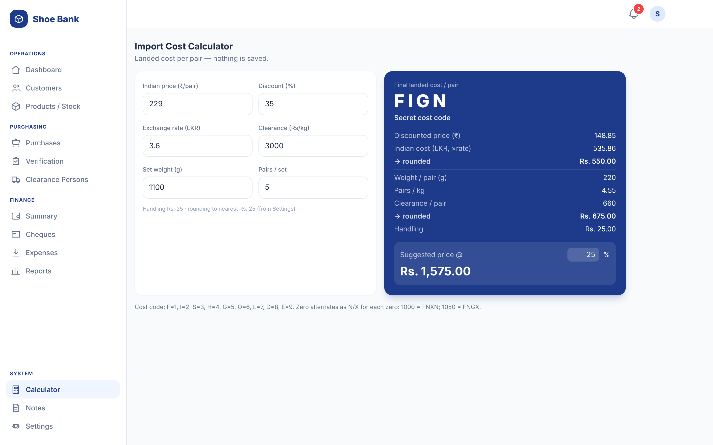
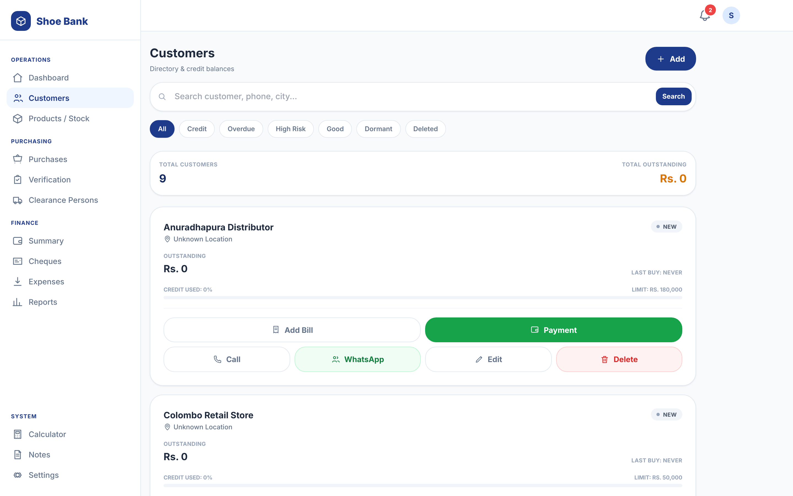
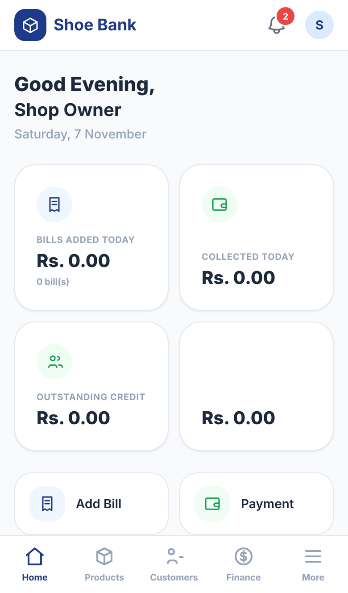
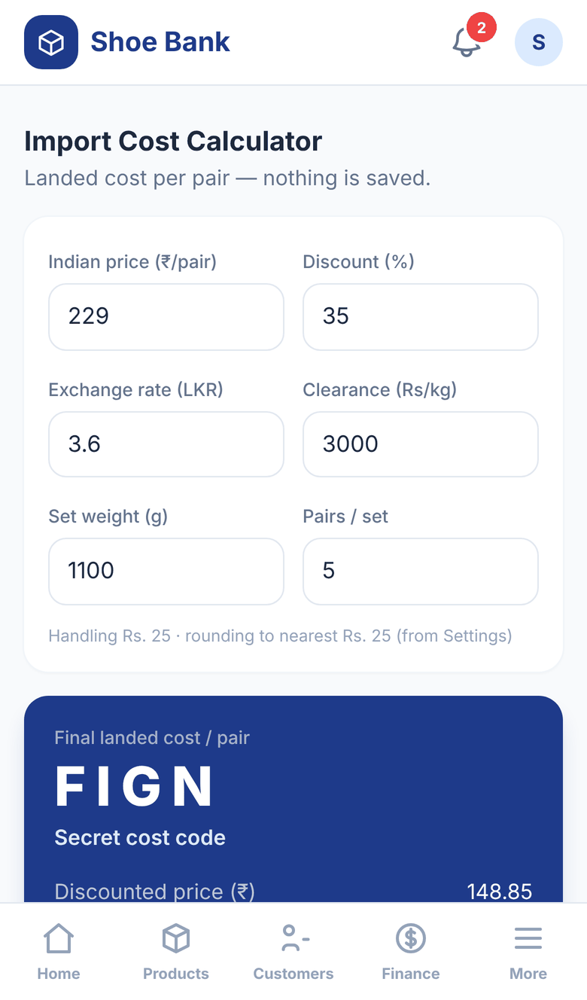

# Shoe Bank — Wholesale Footwear Management

[](https://github.com/HajithMohamed/Footwear_Business_Management_System/actions/workflows/ci.yml)


Mobile-first inventory, import-clearance, credit-sales and reporting system for a Sri Lankan
wholesale footwear shop. Built to run cheaply on cPanel shared hosting.

**Stack:** PHP 8.1+ · MySQL/MariaDB · Tailwind CSS (compiled with the Tailwind CLI) and Alpine.js · custom lightweight MVC (no Composer required).

<!-- Add the live demo link and a read-only demo login here once the production admin password has been changed. -->



## At a glance

| | |
| --- | --- |
| **What it is** | The day-to-day system of a wholesale shoe shop: products and stock, import purchases and clearance, credit sales, customer payments and cheques, expenses, and profit and cash reports |
| **Hardest problem** | Keeping profit and cash honest. Stock purchases are not expenses, a sale with no landed cost has *no* profit rather than zero, a cheque counts only once it clears, and cost of goods is snapshotted onto each invoice (see "How the money adds up") |
| **Architecture** | A custom MVC with no framework: 27 controllers, 24 models and 17 services behind one front controller (`public/index.php`) |
| **Security** | PDO prepared statements with emulation off, a central CSRF check in the router, bcrypt with automatic rehashing, shell-safe OCR calls and an `.htaccess` that blocks script execution in uploads |
| **Tests and CI** | A dependency-free test runner (`php tests/run.php`): 10 test files, 148 assertions. GitHub Actions lints every PHP file and runs the tests on PHP 8.1 and 8.3 |
| **Deployment** | Docker (PHP-Apache + MySQL 8) for local use, and a Render web service with an external MySQL database ([DEPLOYMENT.md](DEPLOYMENT.md)) |

| Customers and credit | On a phone | |
| --- | --- | --- |
|  |  |  |

_Screenshots use the seed data from `database/seed.sql`._

---

## Build status

| Phase | Scope | Status |
|------:|-------|:------:|
| **1** | Auth/RBAC · Settings · Dashboard · **Products (Imported/Local/Custom)** · Media storage · **Cost Calculator (+tests)** | ✅ done |
| **2** | Customers · Payments · **Cheques (deposit dates, images, reminders)** · Ledger · **Customer intelligence (+tests)** | ✅ done |
| **3** | **Sales & Invoicing** · stock deduction · **Expenses** · **Profit & loss reporting** | ✅ done |
| 4 | Import Purchase & Clearance · Parcels · Arrival Verification · OCR | ✅ done |
| 5 | Full Reports/exports · **Auto-cleanup cron** · Backup/Restore · hardening | ⏳ |
| — | PDF invoices · WhatsApp share · CSV export | ⏳ |

---

## How the money adds up

The system answers two different questions, and keeps them apart on purpose:

| | Counts | Where |
|---|---|---|
| **Profit** | Sales − cost of goods sold − operating expenses. A credit sale counts the day it happens. | `/finance/profit-loss` |
| **Cash** | Money that actually arrived. Ignores anything still on a customer's account. | `/finance` |

A wholesale shop selling on two-month credit is routinely profitable and short of cash in the
same month, so both are always shown together.

Three rules keep the figures honest, and are worth knowing before changing anything:

1. **Buying stock is not an expense.** It is money moving from cash into inventory. The cost
   reaches the P&L once, as COGS on the sale that ships it. Import invoices never go in `expenses`.
2. **A sale with no landed cost has no profit, not zero profit.** Those invoices are flagged
   `costed = 0`, still count as revenue, and are excluded from every profit total — with a
   visible warning — rather than reporting the full selling price as margin.
3. **A cheque is only money once it clears.** Pending and bounced cheques are excluded from cash
   collected and reported separately.

Cost of goods is **snapshotted onto the invoice** at the moment of sale. Re-costing a shipment
next month never rewrites the profit on a sale that already happened.

Customer payment behaviour (reliable / slow / defaulter) is derived by replaying each account
chronologically and applying payments to the oldest invoice **that already existed when the
payment arrived** — see `app/Services/CustomerIntelligenceService.php`. It is a cache: rebuild it
any time from `/intelligence` → *Recalculate*.

---

## Run with Docker (recommended)

The only requirement is Docker Desktop. One command builds PHP-Apache + MySQL 8,
imports the schema and seed automatically, and serves the app:

```bash
docker compose up --build -d
```

Then open <http://localhost:8080> and sign in with **admin / admin123**.

| | |
|---|---|
| App | <http://localhost:8080> (host `8080` → container `80`) |
| MySQL | host port `3307` (→ container `3306`), db `footwear_erp`, user `footwear` / `footwear_secret`, root `root_secret` |
| Uploads | persisted in the `uploads` volume |
| Database | persisted in the `dbdata` volume |

```bash
docker compose logs -f app                    # follow app logs
docker compose exec app php tests/run.php     # run the cost tests inside the container
docker compose down                           # stop (keeps data)
docker compose down -v                        # stop AND wipe the db + uploads volumes
```

Credentials and ports live in `docker-compose.yml`; the container generates its `.env`
from those environment variables at startup (see `docker/entrypoint.sh`).

> **Troubleshooting** — if `docker compose up --build` ever ends with
> `failed to solve: image ... already exists` (a Docker Desktop/containerd
> image-store quirk that occurs when the rebuilt image is byte-identical to an
> existing one), the image is already built — just run `docker compose up -d`
> to start it.

---

## Upgrading an existing database

`schema.sql` uses `CREATE TABLE IF NOT EXISTS`, so a fresh install needs nothing extra. An
**existing** database needs the migrations, newest last. Migration 003 (sales, expenses, local
purchases, cheque dates) is additive and idempotent — running it twice is safe.

```bash
docker compose exec -T db mysql -u footwear -pfootwear_secret footwear_erp < database/schema.sql
docker compose exec -T db mysql -u footwear -pfootwear_secret footwear_erp < database/migrations/003_sales_expenses_profitability.sql
```

Then open `/intelligence` and tap **Recalculate** once, to build customer payment history from
the invoices and payments already on file.

---

## Local setup (without Docker)

**Requirements:** PHP 8.1+ (with `pdo_mysql` and `gd`), MySQL/MariaDB.

```bash
# 1. Configure environment
cp .env.example .env          # then edit DB_* values

# 2. Create the database, then import schema + seed
#    (via phpMyAdmin, or the CLI below)
mysql -u root -p -e "CREATE DATABASE footwear_erp CHARACTER SET utf8mb4 COLLATE utf8mb4_unicode_ci;"
mysql -u root -p footwear_erp < database/schema.sql
mysql -u root -p footwear_erp < database/seed.sql

# 3. Run the dev server (document root = /public)
php -S localhost:8000 -t public
```

Open <http://localhost:8000> and sign in:

```
username: admin
password: admin123      # change immediately after first login
```

To reset/recreate the admin account:

```bash
php scripts/create-admin.php admin "a-new-password" "Shop Owner"
```

## Run the tests

A dependency-free test suite (no PHPUnit) covers landed costing, customer intelligence and
statements, flexible article transactions, arrival grouping, OCR parsing, phone numbers, product
media and size sets:

```bash
php tests/run.php
```

---

## Deploying to Render

The application deploys to a Render Docker Web Service and uses an external
MySQL database; it does not run MySQL or a TLS proxy inside Render. See
[DEPLOYMENT.md](DEPLOYMENT.md) for the exact environment variables, database
import, Render settings, storage limitation, and verification steps.

## Project layout

```
app/
  Core/         Router, Request, Database, Auth, Session, View, Model, Validator, Controller
  Controllers/  Auth, Dashboard, Product, Calculator, Setting, Customer, Payment, Cheque,
                Ledger, Purchase, LocalPurchase, Clearance*, Arrival, Costing, Attachment,
                Sales, Expense, Finance, Report
  Models/       Product, Setting, Brand, Category, SizeSet, Customer, Payment, Cheque,
                CustomerTransaction, CustomerIntelligence, Purchase*, Sale, Expense*
  Services/     CostCalculator (unit-tested), PurchaseCosting, LocalPurchaseService,
                SalesService, ProfitService, CustomerIntelligenceService (unit-tested),
                ReportingService, StorageService, InvoiceExtractionService
  Middleware/   Auth, Guest, Admin
  Views/        layouts, partials, auth, dashboard, products, calculator, settings, customers,
                payments, cheques, ledger, intelligence, purchases, arrivals, sales, expenses,
                finance, reports, errors
  Helpers/      helpers.php (env, config, url, setting, csrf, …)
config/         config.php, routes.php
database/       schema.sql, seed.sql, migrations/
public/         index.php (front controller), .htaccess, assets/, uploads/ (protected)
scripts/        create-admin.php
tests/          run.php + 10 *Test.php files (148 assertions)
storage/        logs/, backups/
```

## Notes

- **Tailwind** is compiled with the Tailwind CLI into `public/assets/css/tailwind.css`, which is
  committed, so the app runs without Node.js. After changing classes in the views, rebuild it with
  `npm ci && npm run build:css` (the Docker image does this automatically).
- **Rounding rule:** costs round to the nearest Rs.25 (round-half-up). The owner's `738 → 725`
  example is inconsistent with that and is treated as a value to confirm — change the rule in one
  place: `App\Services\CostCalculator::roundToStep()` (step is also configurable in Settings).
- **Uploads** live in `public/uploads` with an `.htaccess` that blocks script execution.
